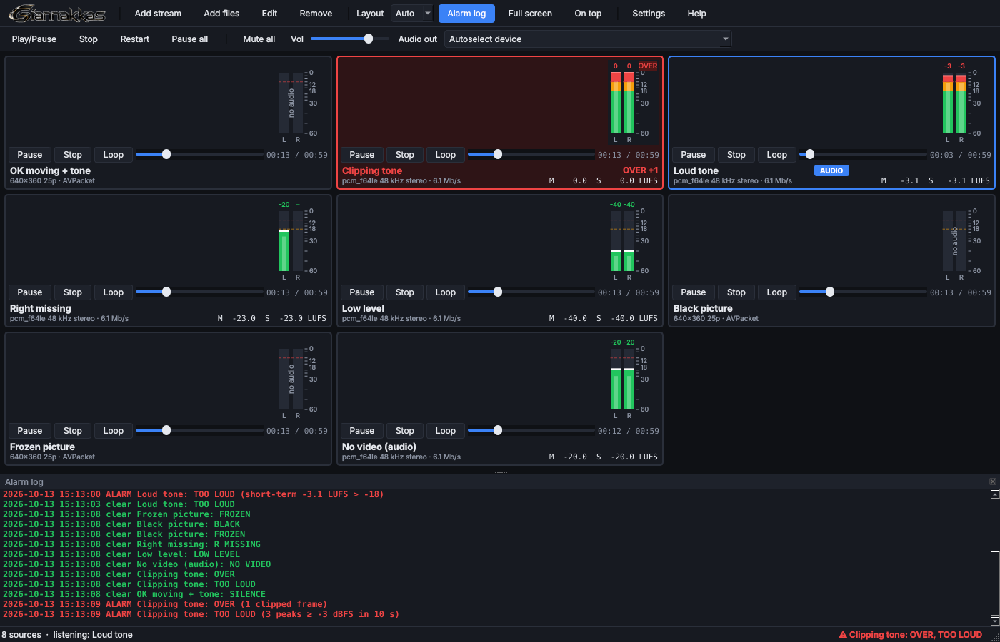

# Barpi Monitor

A Windows desktop program that plays several video sources at once for monitoring
and shows **live audio level meters** for each one. It is a small multiviewer: streams
or files in a grid, one of them audible, every one metered, with SILENCE and NO SIGNAL
alarms.

It lives in this repository because the newsroom asked for it, but it is independent
of the Barpi web app: Python, Qt and libmpv, packaged as a single `BarpiMonitor.exe`.



## Download

Every push that touches `monitor/` builds the exe on GitHub Actions and self-tests it.
Builds from `main` (and manual runs of the workflow) are published as the
**`monitor-latest`** pre-release:

https://github.com/giannakkas/barpi/releases/tag/monitor-latest

Builds from other branches are kept as a workflow artifact instead: open the run under
*Actions → Build Barpi Monitor (Windows exe)* and download `BarpiMonitor-<version>-win64`.

Take `BarpiMonitor.exe` (or the zip, which adds a short README). It needs nothing
installed. The exe is not code-signed, so SmartScreen will ask once: *More info → Run anyway*.

## What it does

| | |
| --- | --- |
| Sources | Files (any format FFmpeg reads), RTSP, SRT, UDP/RTP multicast, RTMP, HLS, HTTP(S) |
| Layout | Automatic grid (1, 2×2, 3×3, 4×4…) or a fixed column count; double-click a tile to show it alone |
| Audio | One tile audible at a time (click or keys 1–9), monitor volume, output device selection, mute-all that keeps metering |
| Meters | Per-channel peak (PPM ballistics) + RMS + peak hold in dBFS, zone-coloured at −18 / −9 dBFS, OVER indicator, EBU R128 momentary & short-term loudness |
| Channels | Mono, stereo, 5.1, 7.1: one bar per channel of the *source*, even when the sound card is stereo |
| Alarms | SILENCE (threshold and duration configurable), NO SIGNAL (drop / error / stall), auto-reconnect with back-off, optional beep |
| Status | Resolution, frame rate, codecs, sample rate, layout and bitrate under each tile; alarm list in the status bar and window title |
| Persistence | Sources, layout, volume, device and window position are saved per user |

## How the meters work

Each tile is its own libmpv instance. Two FFmpeg audio filters are inserted into mpv's
filter chain:

```
astats=metadata=1:reset=1:measure_perchannel=Peak_level+RMS_level
ebur128=metadata=1
```

`astats` tags every decoded audio frame with per-channel peak and RMS level, `ebur128`
with R128 loudness. mpv exposes those tags through its `af-metadata/<label>` property,
which a thread reads 25 times a second (`barpi_monitor/player.py`). The filters run
before mute, volume and the down-mix to the output device, so a muted 5.1 stream still
meters six channels. The widget applies PPM ballistics (instant attack, 20 dB/s release,
1.5 s peak hold) in `barpi_monitor/levels.py`, which is pure Python and unit-tested.

## Running from source

```bash
cd monitor
pip install -r requirements.txt
# Windows: put libmpv-2.dll in monitor/vendor/ (build.ps1 downloads it)
# Linux:   apt install libmpv2
python run_monitor.py                     # or: python -m barpi_monitor
python run_monitor.py --self-test         # checks libmpv, metering and Qt without a window
python -m pytest tests
```

## Building the exe

**On GitHub:** *Actions → Build Barpi Monitor (Windows exe) → Run workflow*. The job
downloads the current libmpv Windows build, runs the unit tests, runs PyInstaller, runs
`BarpiMonitor.exe --self-test` on the result, and publishes the release.

**On a Windows PC** with Python 3.11+:

```powershell
powershell -ExecutionPolicy Bypass -File monitor\build.ps1
```

The result is `monitor\dist\BarpiMonitor.exe`. The script fetches `libmpv-2.dll` from
the mpv Windows builds on GitHub (zhongfly/mpv-winbuild, falling back to
shinchiro/mpv-winbuild-cmake); pass `-MpvArchiveUrl` to pin a particular archive.

**On Linux (cross-build with Wine)**, when no Windows machine or runner is available:

```bash
sudo apt install wine64 p7zip-full gcc-mingw-w64-x86-64
monitor/build-wine.sh        # result: monitor/build-wine/dist/BarpiMonitor.exe
```

It runs the Windows Python and PyInstaller under Wine, builds a stub for the Windows
system ICU library that Qt links against (Wine has none; the stub is not shipped), and
finishes by running the exe's own `--self-test` under Wine. The output is the same bundle
the Windows build produces.

## Files

| | |
| --- | --- |
| `barpi_monitor/levels.py` | dBFS parsing, meter ballistics, silence and over detectors (no Qt, no mpv) |
| `barpi_monitor/player.py` | libmpv wrapper: poll thread, state machine, stall detection, reconnect |
| `barpi_monitor/meter.py` | the meter widget |
| `barpi_monitor/tile.py` | video surface + meter + footer + alarm logic for one source |
| `barpi_monitor/window.py` | grid, toolbar, keyboard, drag & drop, persistence |
| `barpi_monitor/selftest.py` | `--self-test` |
| `BarpiMonitor.spec` | PyInstaller recipe |
| `build.ps1` | local Windows build |
| `../.github/workflows/build-monitor.yml` | CI build and release |

Settings and sources: `%APPDATA%\BarpiMonitor\config.json`. Log: `monitor.log` next to it.

## Troubleshooting

- **The Actions job fails after a few seconds with no log**: open the run and read the
  annotation. "The job was not started because recent account payments have failed or
  your spending limit needs to be increased" means GitHub is refusing to start a hosted
  Windows runner for this private repository (Windows minutes are billed at 2×). Fix it
  under *GitHub → Settings → Billing & plans* (payment method or spending limit) and
  re-run the workflow, or build on a Windows PC with `monitor\build.ps1`.

- **No sound**: pick the device in *Audio out*; check *Mute all* is off and the right tile is selected (blue border, AUDIO badge).
- **RTSP will not connect**: the program forces TCP transport; make sure the camera allows it. The tile's status shows mpv's last error.
- **High CPU with many tiles**: hardware decoding is on by default (Settings); lower the source resolution if the GPU cannot keep up.
- **"libmpv-2.dll could not be loaded"**: the exe is corrupt or blocked; download it again, or put `libmpv-2.dll` next to it.
